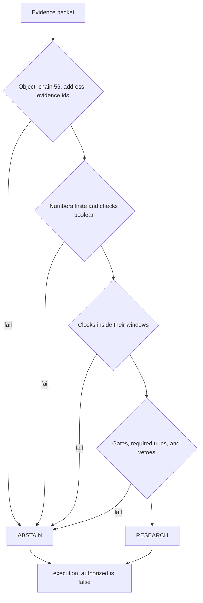

# Panda Agent

<p align="center">
  
</p>

<p align="center">
  
</p>

Panda Agent is the evidence-policy checker for PandaSI. It reads one JSON packet about a BNB Smart Chain token and returns either `RESEARCH` or `ABSTAIN`. A passing result means the packet is complete enough to keep studying. It does not authorize a trade, a signature, or a transfer.

The program in this repository is deterministic. It uses the Python standard library only. It does not open a network connection, does not hold a key, and does not call a remote model. `execution_authorized` is `false` on every path, including a clean fixture and a broken file.

<p align="center">
  
</p>

| | |
| --- | --- |
| Policy | `prototype-v1` |
| Chain | BNB Smart Chain, integer `chain_id` 56 |
| Decisions | `RESEARCH` or `ABSTAIN` |
| Execution | Always unauthorized |
| Runtime | Python 3.9 or newer, standard library |
| Entry point | `panda_agent.py` |

```text
python panda_agent.py
python panda_agent.py --input example_missing_evidence.json
python -m unittest -v
```

## What a decision means

`RESEARCH` is the name of an empty block list. Every schema check, clock, numeric gate, required check, and veto passed. The summary string is fixed:

> Prototype checks passed; continue research. No execution is authorized.

`ABSTAIN` means at least one blocked reason was recorded. Missing data, a stale clock, a failed type, a breached gate, or a veto all take this path. The summary string is also fixed:

> Missing, invalid or vetoed evidence blocks further action.

Neither word is a price view, a safety certificate, or an instruction to buy or sell. The same two uncertainty lines and the same two invalidation lines are attached to both decisions:

| Field | Always reported |
| --- | --- |
| `uncertainties` | Offline input is not independently verified. Portfolio limits and live quote or intent checks sit outside this prototype. |
| `invalidation` | Evidence expires or changes. Liquidity or permissions change. |
| `execution_authorized` | `false` |

Urgency in a surrounding note, a ticker, or a comment inside the packet cannot change the outcome. The checker never reads a field named `metadata`. In the tests, setting `source_verified` to false still abstains when a metadata string tells the program to ignore its rules.

## What this build refuses

| Request | Result in this repository |
| --- | --- |
| Sign, swap, bridge, or send | No signer and no transaction path exist |
| Treat `RESEARCH` as permission | `execution_authorized` stays false |
| Fill a missing field with a guess | The field becomes a blocked reason |
| Accept a future or stale observation | The clock check abstains |
| Follow instructions hidden in token metadata | Those strings are not inputs to the policy |
| Change the policy from the packet | Thresholds live in `POLICY` inside `panda_agent.py` |

## How a packet moves

`evaluate(packet, now=None)` is the whole policy. `now` defaults to the current UTC time, which lets tests freeze the clock. `main` loads JSON from `--input` or builds the fictional jade fixture, prints indented JSON, and exits. A missing file or broken JSON becomes an abstention whose reason starts with `Input error:`.



Reasons accumulate. One bad field does not hide the next. An invalid address and a stale market clock are both listed. Threshold comparisons run only after every numeric field is a finite number greater than or equal to zero, so a negative liquidity value is reported as invalid rather than as "below the floor."

A value that is not a JSON object returns immediately with `Packet must be an object`, an empty evidence list, a null token key, and coverage `0`. Every JSON object continues through the remaining checks.

## Decision, identity, and units

A token is an integer chain plus a contract address. The ticker is not an identity.

`token_key` is `chain_id`, a colon, and `token_address` when the address string is non-empty. Otherwise `token_key` is null. `chain_id` must be the integer `56`. `token_address` must be `0x` followed by exactly 40 hexadecimal digits.

The chain test uses exact integer type, so a boolean or a float such as `56.0` is an unsupported chain. The address test is a full match: the `0x` prefix, forty hex digits, and nothing else. Mixed case is accepted. There is no checksum step. `token_key` is still formed for a non-empty address that fails the pattern, so the key is a label, not evidence that the address passed.

`decision` is `RESEARCH` when the blocked-reason list is empty, and `ABSTAIN` otherwise. `execution_authorized` is false on both results.

Rates in the packet are basis points. One basis point is one hundredth of one percent.

$$
1\,\mathrm{bp} = 10^{-4} = 0.01\%
\qquad
x_{\%} = \frac{x_{\mathrm{bps}}}{100}
$$

So `100` bps is 1 percent, and the tax ceiling of `500` bps is 5 percent. The code compares the raw basis-point numbers. It does not convert them before the test.

## Freshness and coverage

Both observation fields must be timezone-aware ISO-8601 strings. A trailing `Z` is read as UTC. A naive timestamp, a number, or a missing key is invalid.

$$
a(t) = t_{\mathrm{now}} - t
$$

$$
0 \le a(t_{\mathrm{market}}) \le 60
\qquad
0 \le a(t_{\mathrm{security}}) \le 300
$$

The market window is one minute. The security window is five minutes. Age is measured in seconds. The boundary is inclusive: a market observation exactly 60 seconds old still passes, and 61 seconds abstains. A timestamp one second in the future abstains. The tests pin those three edges.

Coverage is a separate count: how many required keys are not null, rounded to three decimal places. It is not a trust score, a probability, or a weighted rating.

The required keys are the seven numeric fields, the six boolean fields, `market_observed_at`, `security_observed_at`, `evidence_ids`, `chain_id`, and `token_address`. That set has 18 keys. Coverage is the number of those keys that are not null, divided by 18, then rounded to three decimal places.

A present value can still be the wrong type, a failing check, or a veto. A fully present packet that trips a veto has coverage `1.0` and decision `ABSTAIN`. The incomplete sample has sixteen of the eighteen keys present, so its coverage is `0.889`.

## Numeric gates

These comparisons run only when all seven numbers are finite and non-negative. A boolean, `NaN`, infinity, a string, or a negative value is `Missing or invalid <field>` and skips this block.

$$
L \ge 100000
\qquad
0 < q \le 100
\qquad
I \le 100
\qquad
S \le 100
\qquad
\max(\tau_{\mathrm{buy}}, \tau_{\mathrm{sell}}) \le 500
\qquad
H_{10} \le 40
$$

| Symbol | Field | Relation | Limit | Blocked reason when it fails | Fixture |
| --- | --- | --- | ---: | --- | ---: |
| \(L\) | `liquidity_usd` | at least | 100000 | Liquidity below floor | 420000 |
| \(q\) | `order_usd` | greater than 0 and at most | 100 | Order outside allowed range | 50 |
| \(I\) | `price_impact_bps` | at most | 100 | Excessive price impact | 30 |
| \(S\) | `slippage_bps` | at most | 100 | Excessive slippage | 50 |
| \(\tau_{\mathrm{buy}}\) | `buy_tax_bps` | the greater tax at most | 500 | Excessive token tax | 0 |
| \(\tau_{\mathrm{sell}}\) | `sell_tax_bps` | the greater tax at most | 500 | Excessive token tax | 0 |
| \(H_{10}\) | `classified_top10_pct` | at most | 40 | Holder concentration above ceiling | 38 |

An order of `0` fails, and an order of `100` passes. Holder concentration of `40` passes, and `40.1` abstains. Impact, slippage, and tax use the same edge: the limit itself passes, and one basis point past it abstains. Liquidity of `99999` is below the floor.

### Reason catalog

| Reason | When it is added |
| --- | --- |
| `Packet must be an object` | The top-level JSON value is not an object |
| `Invalid token address` | The address is missing or is not `0x` plus 40 hex digits |
| `Unsupported chain` | `chain_id` is not the integer 56 |
| `Missing valid evidence IDs` | `evidence_ids` is not a non-empty list of non-blank strings |
| `Missing or invalid <field>` | A numeric or boolean field has the wrong type, is not finite, or is negative |
| `Missing or invalid market_observed_at` | The market stamp is missing or not a zoned timestamp |
| `Missing or invalid security_observed_at` | The security stamp is missing or not a zoned timestamp |
| `Stale or future market_observed_at` | Market age is negative or greater than 60 seconds |
| `Stale or future security_observed_at` | Security age is negative or greater than 300 seconds |
| `Liquidity below floor` | Liquidity is under 100000 USD |
| `Order outside allowed range` | The order is 0 or greater than 100 USD |
| `Excessive price impact` | Impact is above 100 bps |
| `Excessive slippage` | Slippage is above 100 bps |
| `Excessive token tax` | The larger of the buy and sell tax is above 500 bps |
| `Holder concentration above ceiling` | Classified top-ten share is above 40 percent |
| `Required check failed: <field>` | A required boolean is present and `false` |
| `Risk veto: <field>` | `dangerous_permissions` or `provider_conflict` is `true` |
| `Input error: ...` | The command-line file cannot be read or parsed |

## Fields, checks, and vetoes

| Field | Type | Rule |
| --- | --- | --- |
| `chain_id` | integer | Must be 56 |
| `token_address` | string | `0x` and forty hex digits |
| `evidence_ids` | list of strings | At least one, and none blank |
| `market_observed_at` | zoned timestamp | Age from 0 through 60 seconds |
| `security_observed_at` | zoned timestamp | Age from 0 through 300 seconds |
| `liquidity_usd` | finite number ≥ 0 | At least 100000 |
| `order_usd` | finite number ≥ 0 | Greater than 0 and at most 100 |
| `price_impact_bps` | finite number ≥ 0 | At most 100 |
| `slippage_bps` | finite number ≥ 0 | At most 100 |
| `buy_tax_bps` | finite number ≥ 0 | Considered with the sell tax |
| `sell_tax_bps` | finite number ≥ 0 | The larger tax at most 500 |
| `classified_top10_pct` | finite number ≥ 0 | At most 40 |
| `source_verified` | boolean | Must be `true` |
| `sell_simulation_passed` | boolean | Must be `true` |
| `permissions_reviewed` | boolean | Must be `true` |
| `finalized` | boolean | Must be `true` |
| `dangerous_permissions` | boolean | Must be `false` |
| `provider_conflict` | boolean | Must be `false` |

| Boolean | Passing value | Failure text |
| --- | --- | --- |
| `source_verified` | `true` | `Required check failed: source_verified` |
| `sell_simulation_passed` | `true` | `Required check failed: sell_simulation_passed` |
| `permissions_reviewed` | `true` | `Required check failed: permissions_reviewed` |
| `finalized` | `true` | `Required check failed: finalized` |
| `dangerous_permissions` | `false` | `Risk veto: dangerous_permissions` |
| `provider_conflict` | `false` | `Risk veto: provider_conflict` |

JSON `true` and `false` are the only accepted boolean spellings. The string `"true"` fails the type check. JSON `null` also fails that check, and it lowers coverage because null is absent. A required check that is `false` is recorded again as a failed check. A veto records a reason only when the value is `true`; a missing veto field has already failed the type check.

Removing any single key from a complete packet is enough to abstain. The unit tests pop each key in turn and expect `ABSTAIN`.

## Two worked packets

### Passing fixture

`python panda_agent.py` builds this packet with both clocks set to the current UTC time. The address is forty ones. It is a fixture, not a listed contract. Evidence id: `fixture:jade`.

| Field | Value |
| --- | --- |
| `chain_id` | 56 |
| `token_address` | `0x1111111111111111111111111111111111111111` |
| `liquidity_usd` | 420000 |
| `order_usd` | 50 |
| `price_impact_bps` | 30 |
| `slippage_bps` | 50 |
| `buy_tax_bps`, `sell_tax_bps` | 0, 0 |
| `classified_top10_pct` | 38 |
| Required checks | all `true` |
| Vetoes | both `false` |

A run of that command returns:

| Result field | Value |
| --- | --- |
| `token_key` | `56:0x1111111111111111111111111111111111111111` |
| `policy_version` | `prototype-v1` |
| `decision` | `RESEARCH` |
| `blocked_reasons` | empty |
| `field_presence_coverage` | `1.0` |
| `execution_authorized` | `false` |

The saved copy of that shape is `example_output.json`.

### Incomplete sample

`example_missing_evidence.json` keeps the same identity and the same market numbers, then sets `source_verified` and `sell_simulation_passed` to null. Its clocks are fixed at `2026-10-16T17:33:25.657328+00:00`. After the one-minute market window and the five-minute security window, both stamps are stale. A run on 22 October 2026 produced:

| Result field | Value |
| --- | --- |
| `decision` | `ABSTAIN` |
| `field_presence_coverage` | `0.889` |
| `execution_authorized` | `false` |
| Blocked reason | `Missing or invalid source_verified` |
| Blocked reason | `Missing or invalid sell_simulation_passed` |
| Blocked reason | `Stale or future market_observed_at` |
| Blocked reason | `Stale or future security_observed_at` |

Coverage stays `0.889` on later runs because it counts nulls, not age. The stale reasons remain while those two timestamps sit outside the windows. A passing packet needs the two checks set back to `true` and both clocks moved to the present. The program does not fill in the missing checks.

## Run and test

From this directory, with Python 3.9 or newer:

```text
python panda_agent.py
python panda_agent.py --input example_missing_evidence.json
python -m unittest -v
```

No third-party package is imported. `argparse`, `json`, `math`, `re`, `datetime`, and `pathlib` are the whole runtime.

| Test | Behavior it locks |
| --- | --- |
| `test_valid_research_never_authorizes_execution` | The fresh fixture is `RESEARCH` and execution stays false |
| `test_missing_each_critical_field_blocks` | Deleting any key abstains |
| `test_stale_and_future` | Market ages of −1 second and +61 seconds abstain |
| `test_freshness_boundary` | A market age of exactly 60 seconds still researches |
| `test_numeric_thresholds` | Liquidity 99999, order 101, order 0, holders 40.1, tax 501, impact 101, and slippage 101 abstain |
| `test_bool_strings_and_nonfinite_rejected` | The string `true`, boolean `true` used as a number, `NaN`, and infinity abstain |
| `test_conflict_and_permission_veto` | Either veto set to true abstains |
| `test_wrong_chain_and_address` | Chain 1 and address `JADE` abstain |
| `test_untrusted_metadata_cannot_override` | A failed provenance check still abstains when metadata says otherwise |
| `test_non_object` | A JSON array abstains |

## Repository map

| Path | Role |
| --- | --- |
| `panda_agent.py` | Policy constants, `evaluate`, the fixture, and the command line |
| `test_policy.py` | Clock, threshold, type, and veto tests |
| `example_output.json` | Saved result of the passing fixture |
| `example_missing_evidence.json` | Packet with two null checks and fixed clocks |
| `SYSTEM_PROMPT.md` | Production design note, not executed by this program |
| `docs/figures/` | Mark, wordmark, and lockup shown above |
| `.gitignore` | Ignores bytecode, caches, and local environment files |

## This build and the production design

`SYSTEM_PROMPT.md` describes a later research companion. That note is not imported, parsed, or enforced here. Where the two disagree, the running policy is `panda_agent.py`.

| Concern | This repository | Production design note |
| --- | --- | --- |
| How a decision is made | Pure function over one JSON object | A companion explains observations and cites evidence ids |
| Tools | None | Seven named research tools, at most eight calls, once they exist |
| Signing | Impossible in this code | An execution or signing tool is out of bounds |
| Missing evidence | `ABSTAIN` with an explicit reason | Missing fields stay uncertainty, never positive evidence |
| Authorization | `execution_authorized` is false | A future intent schema would still not authorize a trade |
| Policy changes from text | Ignored | Embedded instructions in posts, sites, and tool text are untrusted |

The research tools named in the design note are `get_token_identity`, `get_market_snapshot`, `get_liquidity_quote`, `get_contract_permissions`, `get_holder_distribution`, `get_sell_simulation`, and `get_source_provenance`. They are not implemented in this repository. The interface here is the offline packet above.

Portfolio limits, a live quote, and an exact order intent are named in the result's uncertainty list because this prototype does not check them. Passing the eighteen fields is not a statement that those later gates would pass.

## Figures

| Figure | What it shows |
| --- | --- |
| `docs/figures/pandasi-logo.png` | PandaSI lockup |
| `docs/figures/wordmark.png` | Wordmark |
| `docs/figures/mark.png` | Panda mark |

The mark, wordmark, and lockup are the PandaSI drawings used above.
