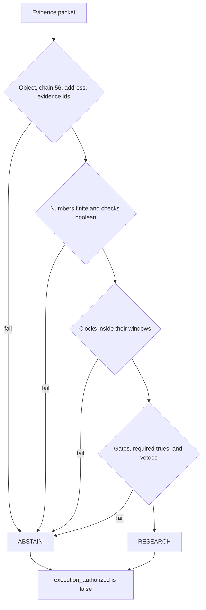

# Panda Agent

<p align="center">
  
</p>

<p align="center">
  
</p>

Panda Agent is the evidence-policy checker for PandaSI. It reads one JSON packet about a BNB Smart Chain token and returns either `RESEARCH` or `ABSTAIN`. A passing result means the packet is complete enough to keep studying. It does not authorize a trade, a signature, or a transfer.

The program in this repository is deterministic. It uses the Python standard library only. It does not open a network connection, does not hold a key, and does not call a remote model. `execution_authorized` is `false` on every path, including a clean fixture and a broken file.

<p align="center">
  
</p>

| | |
| --- | --- |
| Policy | `prototype-v1` |
| Chain | BNB Smart Chain, integer `chain_id` 56 |
| Decisions | `RESEARCH` or `ABSTAIN` |
| Execution | Always unauthorized |
| Runtime | Python 3.9 or newer, standard library |
| Entry point | `panda_agent.py` |

```text
python panda_agent.py
python panda_agent.py --input example_missing_evidence.json
python -m unittest -v
```

## What a decision means

`RESEARCH` is the name of an empty block list. Every schema check, clock, numeric gate, required check, and veto passed. The summary string is fixed:

> Prototype checks passed; continue research. No execution is authorized.

`ABSTAIN` means at least one blocked reason was recorded. Missing data, a stale clock, a failed type, a breached gate, or a veto all take this path. The summary string is also fixed:

> Missing, invalid or vetoed evidence blocks further action.

Neither word is a price view, a safety certificate, or an instruction to buy or sell. The same two uncertainty lines and the same two invalidation lines are attached to both decisions:

| Field | Always reported |
| --- | --- |
| `uncertainties` | Offline input is not independently verified. Portfolio limits and live quote or intent checks sit outside this prototype. |
| `invalidation` | Evidence expires or changes. Liquidity or permissions change. |
| `execution_authorized` | `false` |

Urgency in a surrounding note, a ticker, or a comment inside the packet cannot change the outcome. The checker never reads a field named `metadata`. In the tests, setting `source_verified` to false still abstains when a metadata string tells the program to ignore its rules.

## What this build refuses

| Request | Result in this repository |
| --- | --- |
| Sign, swap, bridge, or send | No signer and no transaction path exist |
| Treat `RESEARCH` as permission | `execution_authorized` stays false |
| Fill a missing field with a guess | The field becomes a blocked reason |
| Accept a future or stale observation | The clock check abstains |
| Follow instructions hidden in token metadata | Those strings are not inputs to the policy |
| Change the policy from the packet | Thresholds live in `POLICY` inside `panda_agent.py` |

## How a packet moves


`evaluate(packet, now=None)` is the whole policy. `now` defaults to the current UTC time, which lets tests freeze the clock. `main` loads JSON from `--input` or builds the fictional jade fixture, prints indented JSON, and exits. A missing file or broken JSON becomes an abstention whose reason starts with `Input error:`.




Reasons accumulate. One bad field does not hide the next. An invalid address and a stale market clock are both listed. Threshold comparisons run only after every numeric field is a finite number greater than or equal to zero, so a negative liquidity value is reported as invalid rather than as "below the floor."

The early exit is narrow. A packet that is not a JSON object returns immediately with `Packet must be an object`, an empty evidence list, a null token key, and coverage `0`. Every dictionary continues through the remaining checks.

## Decision, identity, and units

A token is an integer chain plus a contract address. The ticker is not an identity.

$$
\mathrm{token\_key} =
\begin{cases}
\texttt{chain\_id} \,\Vert\, \texttt{":"} \,\Vert\, \texttt{token\_address} & \text{if the address string is non-empty} \\
\mathrm{null} & \text{otherwise}
\end{cases}
$$

$$
\mathrm{chain\_id} = 56
\qquad
\texttt{token\_address} \sim \texttt{0x[0-9a-fA-F]\{40\}}
$$

The chain test uses exact integer type, so a boolean or a float such as `56.0` is an unsupported chain. The address test is a full match: the `0x` prefix, forty hex digits, and nothing else. Mixed case is accepted. There is no checksum step. `token_key` is still formed for a non-empty address that fails the pattern, so the key is a label, not evidence that the address passed.

Let \(B(p)\) be the list of blocked reasons for packet \(p\).

$$
D(p) =
\begin{cases}
\texttt{RESEARCH} & \text{if } B(p) = \emptyset \\
\texttt{ABSTAIN} & \text{otherwise}
\end{cases}
\qquad
\mathrm{execution\_authorized}(p) = \mathrm{false}
$$

Rates in the packet are basis points. One basis point is one hundredth of one percent.

$$
1\,\mathrm{bp} = 10^{-4} = 0.01\%
\qquad
x_{\%} = \frac{x_{\mathrm{bps}}}{100}
$$

So `100` bps is 1 percent, and the tax ceiling of `500` bps is 5 percent. The code compares the raw basis-point numbers. It does not convert them before the test.

